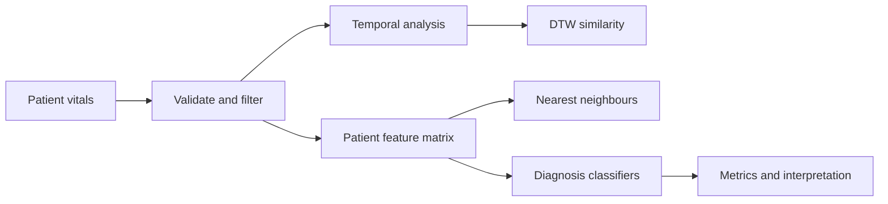
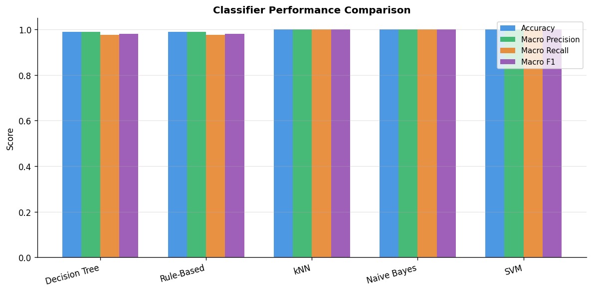

<div align="center">

# Pulse to Prediction

### Mining temporal patterns. Matching patients. Comparing classifiers.

Patient health data explored through time-series analysis, similarity search, and interpretable machine learning.


**[Explore the notebook](i232634_DS-A_Assignment%203_Notebook.ipynb)** · **[Read the report](i232634_DM_Assignment_3_Report.pdf)** · **[Run locally](#run-locally)**

</div>

---

## At a glance

| 500 patients | 59,212 retained readings | 40 patient-level features | 5 diagnosis classes |
| :---: | :---: | :---: | :---: |
| January 1–30, 2024 | From 60,000 original records | Mean, standard deviation, minimum, maximum, slope | Healthy · Hypertension · Arrhythmia · Diabetes · Sleep Disorder |

This **DS-3002 Data Mining, Assignment 3** project follows patient vitals from raw measurements to diagnosis classification. It combines exploratory plots and temporal patterns with patient matching, then compares five classification approaches on a stratified patient-level split.

The repository includes the original executed notebook and PDF report. Figures and metrics below come from the notebook’s saved outputs.

## Inside the analysis

| Stage | Methods | What it explores |
| :--- | :--- | :--- |
| **Preprocessing** | Null checks, physiological range filters, chronological sorting, feature aggregation | Turning repeated measurements into a patient-level feature matrix |
| **A · Temporal patterns** | Heart-rate plots, 7- and 14-reading moving averages, additive decomposition, per-patient ±2σ anomaly flags | Variation, trends, seasonality, and unusual observations |
| **B · Patient similarity** | Euclidean and Manhattan nearest neighbours, Dynamic Time Warping on the first 20 heart-rate readings | Similarity in summary features versus temporal sequences |
| **C · Classification** | Decision Tree, extracted IF–THEN rules, kNN, Gaussian Naïve Bayes, and SVM | Predictive performance and interpretability across five classes |



## Recorded results

The saved experiment uses **400 training patients and 100 test patients**, with a stratified 80/20 split and `random_state=42`.

| Classifier | Accuracy | Macro precision | Macro recall | Macro F1 |
| :--- | ---: | ---: | ---: | ---: |
| Decision Tree | 99.00% | 0.9882 | 0.9750 | 0.9806 |
| Rule-Based | 99.00% | 0.9882 | 0.9750 | 0.9806 |
| kNN | 100.00% | 1.0000 | 1.0000 | 1.0000 |
| Gaussian Naïve Bayes | 100.00% | 1.0000 | 1.0000 | 1.0000 |
| SVM | 100.00% | 1.0000 | 1.0000 | 1.0000 |



The notebook selects a depth-4 Decision Tree, `k=1` for kNN, and an RBF SVM with `C=0.1`. Its discussion favors the Decision Tree for readable decision paths; kNN, Naïve Bayes, and SVM tie on the recorded test accuracy.

### Interpreting these scores

These are saved assignment results, not a fresh reproduction. The notebook fits `StandardScaler` before the train/test split and selects kNN’s `k` using test accuracy. Those choices can make evaluation optimistic. A stricter follow-up would fit preprocessing within training folds, tune hyperparameters on validation data, and reserve the test set for final evaluation. This project is an academic analysis rather than a clinically validated diagnostic system.

## Run locally

### 1. Clone and create an environment

The notebook records Python **3.13.1** in its metadata. Dependency versions were not captured, so `requirements.txt` lists the imported libraries without claiming an exact environment lock.

```powershell
git clone https://github.com/Saif1Shahzad/pulse-to-prediction.git
cd pulse-to-prediction
python -m venv .venv
.\.venv\Scripts\python.exe -m pip install -r requirements.txt
```

On macOS or Linux, use `.venv/bin/python` in place of `.\.venv\Scripts\python.exe`.

### 2. Add the dataset

**`patient_vitals.csv` is required and is not included in this repository.** Obtain the original assignment dataset and place it in the repository root beside the notebook. The notebook loads it with:

```python
df = pd.read_csv('patient_vitals.csv', parse_dates=['Timestamp'])
```

The original saved input has 13 columns:

| Role | Columns |
| :--- | :--- |
| Identity and time | `PatientID`, `Timestamp` |
| Vital measurements | `HeartRate`, `BloodPressureSystolic`, `BloodPressureDiastolic`, `BloodOxygenLevel`, `BodyTemperature`, `RespiratoryRate` |
| Lifestyle | `SleepHours`, `StressLevel` |
| Demographics | `Age`, `Gender` |
| Target | `Diagnosis` |

`StepCount` is handled as an optional feature if present; it is absent from the saved 13-column input. The recorded 40-feature matrix summarizes eight available vital/lifestyle measurements using five statistics each.

### 3. Open the notebook

```powershell
.\.venv\Scripts\python.exe -m jupyter lab
```

Open `i232634_DS-A_Assignment 3_Notebook.ipynb` and run the cells from top to bottom. Run Jupyter from the repository root so the relative CSV path resolves. Plot cells also save PNG files into the working directory. DTW uses `distance_matrix_fast`, which requires the compiled C extension supplied by a compatible `dtaidistance` installation.

You can browse the existing notebook outputs or the PDF report without the CSV.

## Repository guide

```text
pulse-to-prediction/
├── assets/
│   └── classifier-comparison.png            # Chart extracted from saved notebook output
├── i232634_DS-A_Assignment 3_Notebook.ipynb  # Complete analysis with saved outputs
├── i232634_DM_Assignment_3_Report.pdf        # Assignment report
├── requirements.txt                        # Notebook libraries and JupyterLab
├── .gitignore                              # Local environment and cache exclusions
└── README.md
```

## Author

**Saif Shahzad** · Roll No. **23i-2634** · Section **DS-A**  
**DS-3002 Data Mining — Assignment 3**
